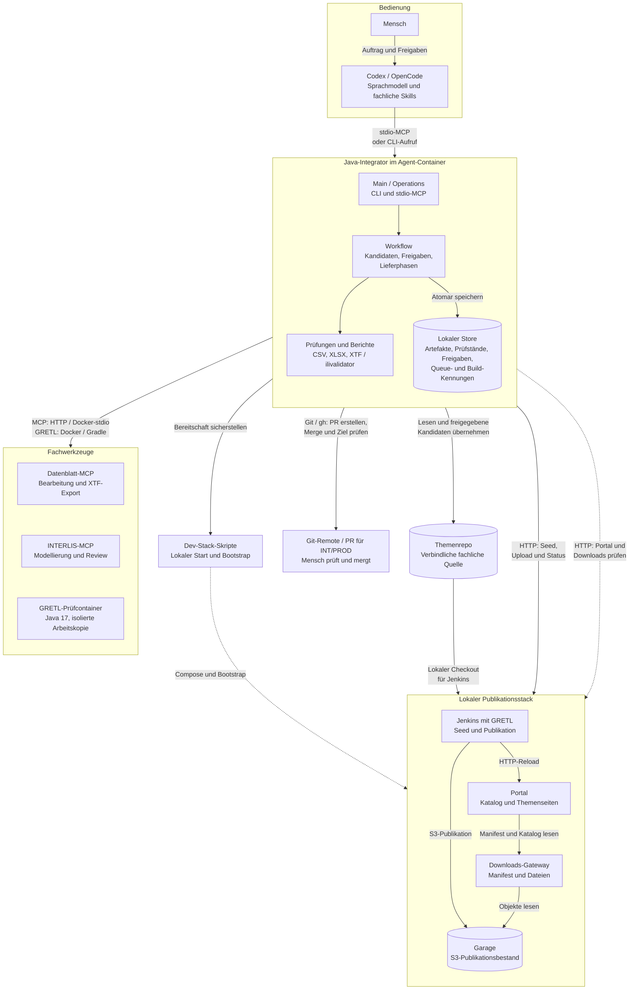
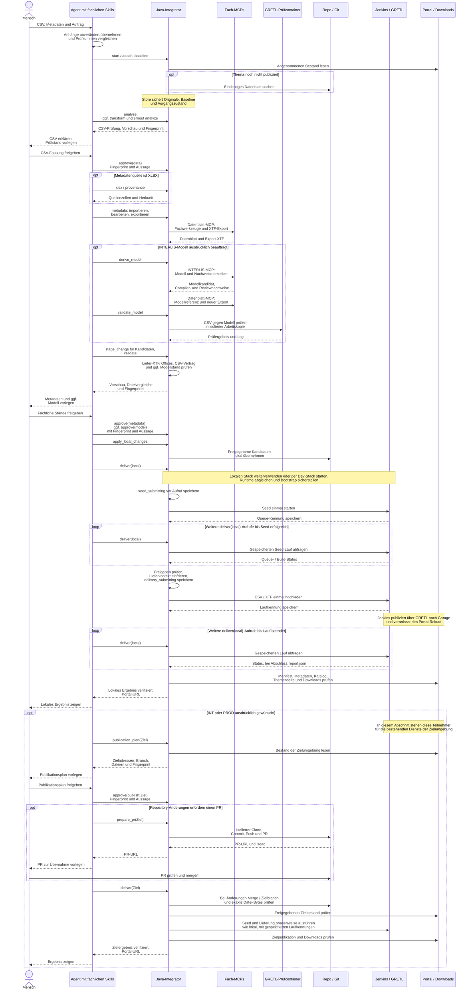

# Entwicklerhandbuch

## Vollständige synthetische Docker-Abnahme

```sh
./bin/datenportal-agent acceptance delivery
```

Die explizite Abnahme erzeugt private Themen-/Stack-Kopien und eigene Ports,
startet die Infrastruktur mit der Host-Docker-CLI und führt Modellierung und
Anlieferung über die erzeugten Codex-/OpenCode-MCP-Konfigurationen im
Agent-Container aus. Sie verwendet nur ausdrücklich markierte synthetische
Freigaben und die Testzugänge des eigenen JCasC-Stacks. `init` führt diese
Publikationsabnahme nicht automatisch aus.

Der Positivfall muss GRETL-Validierung, Publikation, Manifest, Portal und Download
bestätigen. Der Negativfall wird gezielt an die echte Jenkins-Schnittstelle der
Testinstanz geliefert: ein CSV-Validierungsfehler muss vor
`preparePublicationWorkspace` stoppen, ohne den Release zu ändern. Infrastruktur-
und Anmeldungsfehler sind keine bestandenen Negativtests.

Die erzeugte CSV-Task verwendet einen abhängigen Gradle-`Copy`-Task mit `from`,
`into` und `rename`: Jenkins-Uploads ohne Endung werden bytegleich als
`build/integrator-validation/input.csv` geprüft. Der Upload bleibt unverändert.
Bereits zuvor erzeugte Taskdefinitionen benötigen eine erneute Modellableitung
mit der bestehenden Identität, Prüfung und Freigabe der geänderten Task. Alte
fachliche Kandidaten werden bei einem Softwareupdate nicht automatisch geändert.

Berichte liegen unter `.datenportal-integrator/delivery-acceptance/<UUID>/`.
Die Abnahme entfernt ausschliesslich ihre eigenen Container, Volumes und Secrets.
Die vorhandenen Fach-MCPs, der normale Dev-Stack und fachliche Vorgänge bleiben
ausserhalb dieser Abnahme.


## Docker-Anlieferung und lokale Zugangsdaten

`bin/datenportal-agent acceptance delivery` verwendet `DeliveryAcceptance` für
private Fixtures und echte MCP-Aufrufe. Der Launcher startet ihre Infrastruktur
bewusst mit der Host-Compose-CLI; dadurch prüft der Agent auch Mount-Metadaten
eines hostseitig erzeugten Stacks. Bestehende Jenkins-, Downloads- und
Garage-Container müssen anhand Identität und Startzeit erhalten bleiben.
Der Negativfall verwendet die echte Jenkins-Schnittstelle der Fixture, um die
frühe Integrator-CSV-Sperre gezielt für den Jenkins-Regressionsnachweis zu umgehen.
Dies erteilt keine Freigabe für einen fachlichen Vorgang.

`Models.task` erzeugt `stageThemenCsv` als Gradle-`Copy`-Task. Er erhält die
Eingabebytes und ergänzt für den GRETL-Validator die fehlende `.csv`-Endung von
Jenkins-Dateiparametern. `validateThemenCsv` hängt davon ab und bestätigt die
Bytegleichheit mit `Files.mismatch` vor der bestehenden Modell-/Bundle-Prüfung.
Nach der Projektkonfiguration erhält der vorhandene `validateDeliveredCsv`-Task
zusätzlich den Themenordner als Modellquelle; der festgelegte Modellbestand des
Images bleibt enthalten. Minimale Prüfprojekte ohne diesen Publikations-Task
benötigen keine solche Erweiterung.
Der echte Jenkins-Regressionstest verwendet absichtlich endungslose Uploadpfade
und vergleicht die SHA-256-Prüfsummen von Quelle und Prüfkopie.

`Credentials` ist der gemeinsame Resolver für HTTP, Bootstrap und `doctor`.
Der lokale Store wird bei jedem neuen authentifizierten Aufruf gelesen und ist
an Profil/Jenkins-Basis gebunden. Schreibzugriffe verwenden private temporäre
Dateien, eine Prozesssperre und atomaren Austausch. `Value` wird nicht in
Vorgänge oder JSON-Berichte aufgenommen. Der Bootstrap erhält nur seine zwei
benannten Zugangsdatenvariablen über `ProcessBuilder.environment`; dieser
Prozesspfad bereinigt Text und Basic-Auth-Werte vor dem Schreiben von Logs.
Der Jenkins-HTTP-Client erhält für jeden neuen authentifizierten Workflow-Aufruf
einen eigenen Cookie-Store. Damit bleiben CSRF-Crumb und Session-Cookie innerhalb
eines POST-Ablaufs zusammen; CSRF wird nicht abgeschaltet. Dies ist insbesondere
für die ausdrücklich gespeicherten Passwortzugänge der synthetischen JCasC-Fixture
erforderlich, siehe [Jenkins: Scripted Clients](https://www.jenkins.io/doc/book/security/csrf-protection/#working-with-scripted-clients).

`Stack.inspect` verwendet ein begrenztes Docker-Format statt vollständiger
Container-Konfigurationen. Eine nicht direkt auflösbare `/host_mnt/`-Quelle wird
nur bei `OperatingSystem=Docker Desktop` übersetzt und anschliessend mit dem
realen Themenrepo-Pfad verglichen. Andere Quellen und Betriebsmodi bleiben
gesperrt; es gibt keine automatische Container-Neuerstellung als Umgehung.

## Docker-Launcher und Initialisierung

`bin/datenportal-agent` startet das veröffentlichte Agent-Image mit eingebautem
JAR und JDK 25. Immutable Ressourcen werden über `AgentResources` unter
`/opt/datenportal-agent` aufgelöst; Konfiguration, Credentials, Themencheckouts
und Vorgänge bleiben im schreibbaren Workspace. Im Entwicklungsmodus ohne
`DATENPORTAL_AGENT_HOME` gelten die bisherigen Checkout-Pfade.

Die erste Auswahl lädt `sogis/datenportal-themenintegrator-agent:latest`.
`.datenportal-integrator/launcher/release-image` speichert atomar Referenz,
Repo-Digest und lokale Image-ID. `--update-agent` prüft den neuen Stand mit einem
netzlosen CLI-Start, bevor die Auswahl ersetzt wird. Ohne Update wird nicht
nach `latest` gesucht; fehlende lokale Images werden per gespeichertem Digest
wiederhergestellt. `image.id` bezeichnet das zuletzt gestartete Image,
`build-image.id` separat den Entwicklungscontainer.

`--runtime docker-build` baut die Stufe `tools` und anschliessend das aktuelle
Checkout-JAR. `gradle …` wählt diesen Modus automatisch. `--runtime local`
benötigt weiterhin Host-JDK 25. Die Moduswahl bleibt in erzeugten Harness-Aufrufen
erhalten; `--update-agent` wird nicht als dauerhafte Startoption gespeichert.

Build und Runtime sprechen Host-Docker über dessen Unix-Socket an.
Image-Auswahl und Builds sind serialisiert; Build-/Pull-Ausgaben gehen nach
stderr, CLI/MCP-Ausgaben nach stdout. Der Buildcache ist ein benanntes Volume;
der Entwicklungs-JAR-Build verwendet ein Bridge-Netz. Agent und explizite
Gradle-Testläufe verwenden Host-Networking mit IPv4. Arbeitsdateien behalten die
Host-UID/GID. Nach hartem Abbruch zuerst PID und laufende Container klären, bevor
eine verwaiste `.datenportal-integrator/launcher/build.lock` entfernt wird.
Der Netzwerk-Selbsttest startet das JAR im gleichen Release-Image; im
Entwicklungsmodus verwendet er weiterhin einen expliziten Host-JAR-Mount.

`Initializer` speichert abgeschlossene Schritte und Fehler atomar. `AgentRuntime`
prüft Host-Loopback mit einem kurzlebigen, nur an 127.0.0.1 veröffentlichten
Geschwistercontainer. `Harness` bearbeitet ausschliesslich bekannte MCP-Einträge
und erhält fremde Einstellungen. `Smoke` verwendet private Repository-/Run-Pfade,
keine Publikationsprofile und ausdrücklich markierte synthetische Freigaben.
Der Negativnachweis verlangt einen echten CSV-Validierungsfehler.

Der Smoke-Fingerprint bindet Agent-JAR, Agent-Image, Java-Version,
Konfigurations-/Werkzeugfingerprint, Fixturedateien und relevante GRETL-Quellen.
Protokolle und Kandidaten bleiben erhalten, private Arbeitskopien werden nach
Erfolg entfernt. Der bestehende GRETL-Daemon wird weiterverwendet.

```sh
./bin/datenportal-agent gradle test jar spotlessCheck
./bin/datenportal-agent gradle integrationTest
```

Unit-Tests verwenden das temporäre Linux-Dateisystem des Testcontainers, damit
POSIX-Eigentums-/Rechteprüfungen nicht von VirtioFS-Metadaten abhängen.
Integrationstests verwenden im Docker-Modus ein hostseitig gemountetes temporäres
Verzeichnis, damit Docker-Bind-Mounts auch aus Tests gültig sind. Keine neuen
Python-Quellen: Python im Image ist nur Laufzeit des unveränderten externen
Dev-Stack-Bootstraps.

Die eigenständigen Java-Prüfprogramme `LauncherAcceptance` und `InitAcceptance`
laufen nach Gradle. Sie dürfen nicht innerhalb einer laufenden Gradle-Task
gestartet werden: Der Launcher-Test startet weitere Launcher und würde auf die
noch gehaltene Build-Sperre warten. Nach dem obigen Build lässt sich die echte
Abnahme mit dem bereits gebauten Runtime-Image ausführen:

```sh
repo_dir=$(pwd -P)
runtime_image=$(cat .datenportal-integrator/launcher/image.id)
socket_path=$(docker context inspect --format '{{.Endpoints.docker.Host}}')
socket_path=${socket_path#unix://}
socket_group=$(docker run --rm --mount "type=bind,source=$socket_path,target=/var/run/docker.sock" --entrypoint stat "$runtime_image" -c '%g' /var/run/docker.sock)
docker run --rm --network host --user "$(id -u):$(id -g)" --group-add "$socket_group" \
  --mount "type=bind,source=$(dirname "$repo_dir"),target=$(dirname "$repo_dir")" \
  --mount "type=bind,source=$socket_path,target=/var/run/docker.sock" \
  -w "$repo_dir" -e HOME=/tmp -e JAVA_HOME=/no-host-jdk \
  -e JAVA_TOOL_OPTIONS=-Djava.net.preferIPv4Stack=true \
  -e DATENPORTAL_CONTAINER_MODE=true -e "DATENPORTAL_RUNTIME_IMAGE=$runtime_image" \
  --entrypoint bash "$runtime_image" -c '
    /opt/java/openjdk/bin/java -cp build/classes/java/test:build/libs/datenportal-integrator.jar ch.so.agi.integrator.LauncherAcceptance "$PWD" &&
    /opt/java/openjdk/bin/java -cp build/classes/java/test:build/libs/datenportal-integrator.jar ch.so.agi.integrator.InitAcceptance "$PWD"
  '
```

Die zweite Prüfung kopiert einen privaten Entwicklungs-Checkout und verwendet den echten Docker-Launcher mit eigenen Ports und Compose-Projekt. Sie prüft Ersteinrichtung mit bytegleicher Übernahme der Vorlage und ihren Image-Pins, Wiederholung, `doctor`, beide erzeugten MCP-Verbindungen und `--skip-smoke` und entfernt nur ihre eigenen Dienste/Volumes.
Ihre Berichte bleiben unter `.datenportal-integrator/init-acceptance/` erhalten. Als zweites Argument akzeptiert `InitAcceptance` einen absoluten Pfad zu einer abweichenden Quellkonfiguration; die erzeugte Testkonfiguration hat keine aktiven Publikationsprofile.

### Erweiterte Laufzeitkonfiguration

Der [Docker-Einstieg](anwenderhandbuch.md#installation-und-konfiguration) ist
der Anwenderweg. Die folgenden Modi sind für Entwicklung und isolierte Tests:

```sh
./bin/datenportal-agent --runtime docker-build init
./bin/datenportal-agent --runtime docker-build doctor
./bin/datenportal-agent --runtime local doctor
./bin/datenportal-agent harness-config
```

`docker-build` baut die Checkout-Quellen im Container; `local` verwendet ein
vorhandenes JDK 25 über `JAVA_HOME` oder `DATENPORTAL_JAVA_COMMAND`.
`serve` startet den stdio-MCP und wartet auf einen Client; es ist kein
zusätzlicher interaktiver Einrichtungsschritt. Direkte Java-Aufrufe bleiben
für die Agent-Entwicklung verfügbar. Ein direkter Fach-MCP-JAR-Start wird
hingegen nicht unterstützt.

Die aktuelle Konfiguration verlangt `[datasheet]`; `[interlis]` ist optional,
wenn kein Modellierungsablauf verwendet wird. Beide Abschnitte unterstützen
`transport="http"` mit `url` oder `transport="stdio"` mit einem Docker-`image`.
Bei verwaltetem HTTP sind `managed=true`, Image und eine lokale Adresse mit
explizitem Port und `/mcp` nötig. Unverwaltete HTTP-Dienste startet der Integrator
nicht. Das Datenblatt-Image liefert zusätzlich die Originalmodelle; ohne Image
müssen diese über `model_dirs` erreichbar sein. `setup-mcps` kopiert sie aus
einem gestoppten Image-Container. Im stdio-Modus werden `url` und `managed`
entfernt; jede Verbindung startet einen eigenen Docker-Container.

`[gretl].mode="compose"` hält den Prüfcontainer verfügbar; `"ephemeral"`
startet pro Prüfung einen eigenen Container. Ohne `mode` gilt `ephemeral`,
die vollständige Standardvorlage wählt ausdrücklich `compose`.
GRETL verwendet immer Java 17 und das Bundle im festgelegten Jenkins-Image.
`setup-gretl` inventarisiert das Image ohne laufenden Jenkins-Server.

`timeout_seconds` gilt standardmässig 300 Sekunden; `stack_timeout_seconds`
1800 Sekunden für Stack-/Dienststart und Bootstrap. Beide sind auf 1–7200
begrenzt. Schema und Java-Prüfung verwenden dieselben aktuellen Felder und
Typen; `SettingsTest` prüft die Vorlage sowie ungültige Werte. Die Betriebs-
und Update-Rezepte stehen im Anwenderhandbuch; Setup-Helfer sind kein zweiter
Standardinstallationsweg.

## Architektur und Verantwortlichkeiten

JDK 25, Gradle-Wrapper und ein ausführbares JAR bilden die Implementierung. `Main` stellt CLI und stdio-MCP bereit. Beide dispatchen über `Operations` in denselben `Workflow`. Das Sprachmodell und die fachliche Kommunikation bleiben im Harness. Es gibt keinen eigenen Modellclient und keinen zusätzlichen Integrator-Webserver.

### Zusammenspiel der Komponenten

Die Skizze zeigt den lokalen Standardbetrieb sowie den Git-Weg zu INT/PROD.
Die beschrifteten Verbindungen zeigen Aufrufe, Zugriffe und die Bereitstellung
des lokalen Themencheckouts für Jenkins. Antworten sind der Übersicht halber
nicht separat eingezeichnet. Menschliche Freigaben gelangen über den Agenten
zum Integrator und gelten jeweils für den konkret gezeigten Prüfstand.



Der Launcher startet standardmässig das veröffentlichte Agent-Image mit JDK 25.
Vorgänge und Artefakte im lokalen Store bleiben im eingebundenen Workspace
erhalten, unabhängig von der Lebensdauer des Agent-Containers.
Die beiden Fach-MCPs laufen im lokalen Beispiel als dauerhafte HTTP-Dienste;
weitere unterstützte Transporte stehen unter [Externe Schnittstellen](#bestehende-externe-schnittstellen).
Der separate GRETL-Prüfcontainer verwendet das festgelegte Jenkins-Image mit
Java 17 und dessen Bundle, führt aber keinen Jenkins-Controller aus. Er prüft
Kandidaten in isolierten Arbeitskopien. Erst die Lieferung an Jenkins führt zur
Publikation; zuvor gleicht der Integrator die lokale Jenkins-Runtime mit dem
GRETL-Prüfstand ab.

Der Dev-Stack verantwortet den lokalen Start einschliesslich Garage, Downloads
und Portal sowie den Erstaufbau. Für INT/PROD verwendet der Integrator bestehende
Zielinstanzen: Jenkins bezieht das Themenrepo dort im Modus `managed-git` aus dem
freigegebenen Zielbranch, ohne Git-Rückschreiben. Der PR-Weg in der Skizze gilt
für diese Zielumgebungen, nicht für die lokale Übernahme von Kandidaten.

### Sequenz einer Themenintegration

Der Ablauf zeigt ein Thema mit CSV und neuen oder geänderten Metadaten.
Der Teilnehmer **Fach-MCPs** fasst Datenblatt-MCP und INTERLIS-MCP zusammen;
die Nachrichten benennen den jeweiligen Dienst. **Repo / Git** umfasst den
lokalen Themencheckout und den optionalen PR im Zielrepository. Der lokale
Zustand wird beim Integrator gezeigt. Nur erfolgreiche Prüfungen führen zu den
nachfolgenden Schritten; Korrekturen erfordern neue Prüfstände und Freigaben.



Jeder `deliver`-Aufruf führt höchstens eine externe Phase weiter. Die Schleifen
stehen für weitere Agent-Aufrufe mit derselben Vorgangs-ID; der Integrator
fragt die gespeicherten Queue-/Build-Kennungen ab. Bei unbestätigtem Start
(`submission_unknown`) zuerst mit `reconcile_seed` beziehungsweise `reconcile`
den bestehenden Lauf zuordnen, niemals den Upload blind wiederholen.
Publikationsannahme und erfolgreicher Reload sind getrennte Ergebnisse;
`verify_delivery` prüft eine angenommene Publikation erneut ohne Upload.

INT/PROD benötigen einen erfolgreichen lokalen Gesamttest für denselben Stand
und eine eigene menschliche Zielfreigabe. Ohne Repository-Änderungen entfällt
der PR. Reine Daten- oder Metadatenlieferungen sowie eigenständige Modell- und
Organisationsvorgänge sind im [Anwenderhandbuch](anwenderhandbuch.md) beschrieben.

### Verantwortlichkeiten im Java-Kern

| Komponente | Verantwortung |
|---|---|
| `Settings`, `Json`, `Problem`, `ProcessRunner` | TOML, Pfadgrenzen, Prüfsummen, atomare Speicherung, strukturierte Fehler und externe Prozesse |
| `Store` | Vorgänge, Dateiartefakte, Sperren, Ereignisse und Prüfung des aktuellen Schemas |
| `Workflow` | Operationen, Prüfstände, Freigabeabhängigkeiten, Kandidaten und lokale Übernahme |
| `Csv`, `Xml`, `Validator`, `Reports` | Vollständige technische CSV-Prüfung, sicherer XML-Leser, externe ilivalidator-Aufrufe, XLSX/HTML |
| `McpClients` | Verzögert initialisierte, wiederverwendete SDK-Clients für beide Fach-MCPs über Docker-stdio oder HTTP |
| `Models` | Typisierte flache Ableitung, Herkunft, High-Level-Nachweise, Modellreferenz und GRETL-Themenhook |
| `Organizations` | Office-Regeln aus kompiliertem Modell, Org-/Teamkandidaten und Gradle-Prüfung |
| `Converters`, `CsvConverter`, `ConverterMain` | Java-Konvertervertrag, Kompilierung, JUnit und separate Ausführungs-JVM |
| `Workspace`, `GretlRuntime` | Isolierte Arbeitskopie, festgelegtes GRETL-Image und separate Prüfcontainer |
| `Stack`, `Jenkins`, `Deliveries`, `Repository` | Vorhandene Runtime-Schnittstellen, persistierte Lieferphasen, Sichtbarkeitsprüfung und menschliches PR-Verfahren |
| `DockerMcps`, `Setup` | Festgelegte Image-Auswahl, Originalmodellcache, eigene Container, Werkzeuge und Harness-Konfiguration |

Alle Quellen liegen unter `src/main/java/ch/so/agi/integrator/`, JUnit unter `src/test/java/`. Fachliche Konverter liegen optional unter `topics/<organisation>/<identifier>/`. Regeln, Zusatzmodell und HTML-Vorlage bleiben im Integrator-Repo. Das Themenrepo ist die verbindliche Quelle für Organisationen, Dienststellen, Teams und Datenblätter; der Integrator pflegt keine zweite Kopie.

## Bestehende externe Schnittstellen

Die Anweisungen sind in drei gemeinsam ausgelieferte Skills aufgeteilt:
Themenintegration, eigenständiges Validierungsmodell und Organisationsanlage.
Die Auswahl steht in `AGENTS.md`; `.agents/skills/` enthält relative
Verknüpfungen nach `skills/`. Gemeinsame Verfahren liegen unter `docs/agent/`,
Modellmethodik und Reparatur im Modellskill. Referenzen werden beim jeweiligen
Leseanlass geladen. Die [Eingangsdateiregel](agent/eingangsdateien.md) gilt vor
CSV-Übergabe und Anhangübernahme.

Alle Skills verwenden dieselbe CLI/MCP und das bestehende Zustandsschema.
Integrierte Modellierung bleibt im Themenvorgang mit beiden fachlichen Gates;
eine Skillauswahl erzeugt keinen neuen Vorgang und keinen anderen MCP-Server.
Die synthetische Abnahme kopiert Skills, Dokumentation und Routing-Regeln in
ihren privaten Root und verknüpft dort ausschliesslich diese Kopien. Der
Dokumentationstest prüft rekursiv Referenzen, Frontmatter und Verknüpfungen;
Agentensitzungen prüfen separat Auswahl, Referenzzugriffe und Stopps.

`SkillReplay` unter den Java-Testquellen stellt dafür ausschliesslich
aufgezeichnete Antworten aus `<Antwortordner>/<operation>.json` einer mit
`SYNTHETIC_TEST_FIXTURE` markierten Umgebung bereit und protokolliert Aufrufe
in `calls.jsonl`. Argumente werden gegen die vorhandenen Operationsschemas
geprüft. Den Antwortordner separat und schreibgeschützt in den Testcontainer
einbinden und als zweites Java-Argument übergeben; auch er benötigt die
Fixture-Markierung. So liegen die simulierten Ergebnisse ausserhalb des
Agentenarbeitsbereichs. Optional mitgelieferte Dateien unter `artifacts/<operation>/`
werden erst beim zugehörigen Aufruf in die private Umgebung kopiert, damit
ein vorab vorhandener Bericht keine ausgeführte Prüfung vortäuscht.
Der Testserver verwendet keine Fachclients, Zugangsdaten oder
Publikationsschnittstellen; ein Docker-Aufruf mit `--network none`, einem
privaten Fixture-Mount und schreibgeschütztem Test-Classpath genügt.
Diese Replay-Prüfung belegt Agentenentscheidungen mit simulierten Ergebnissen,
keine erfolgreiche Ausführung der Fachwerkzeuge. Client-Version, Modell,
Prompt, Antworten und Sitzungsprotokoll gehören zum jeweiligen Nachweis.

Keine Quellen von Dev-Stack, Fachdiensten, Jenkins-Plugin, GRETL oder Portal werden geändert. Änderungen an diesen Komponenten sind separate Aufträge. Relevante Grenzen werden als konkrete Fehler gemeldet.

- Datenblatt-MCP: Docker-stdio oder Streamable HTTP, `describe_schema`, `import_xtf`, `read_datasheet`, `update_metadata`, Attribut-/Ausgabenwerkzeuge, Validierung und Export. Der Integrator erzeugt nur die Transferidentität eines leeren Imports mit gültigem OID-Präfix; fachliche Datenblätter und ihre Exporte verantwortet der Fach-MCP.
- INTERLIS-MCP: eigenes SDK-Client/Transport-Paar; im lokalen Beispiel als verwalteter HTTP-Compose-Dienst, weiterhin Docker-stdio, externes Streamable HTTP oder vorhandenes lokales JAR. `authorIliModel` und `applyIliModelChanges` liefern Compiler-/Regel-/Constraint-Nachweise. Bei separat geändertem Quellstand `reviewIliModel`; unvollständige Constraint-Beweise verlangen weiterhin High-Level-Änderung/Prüfung.
- GRETL: vorhandenes Java-17-Skript, Repository-Wrapper und `shared/gradle/init.gradle`; Versionen aus `shared/gradle/gradle-build.properties`. `setup-gretl [--update]` sichert ein veröffentlichtes Jenkins-Image und den darin vorhandenen Bundle-Stand. Java 17 und JARs werden ausschliesslich im Container verwendet.
- Stack: Docker-/Compose-Status, Mount und `THEMEN_REPO_MODE`, vollständiges
  `scripts/up.sh` und gemeinsames `scripts/bootstrap.sh [-f DATEI ...]`.
  Ein kalter Agentstart verwendet zunächst `up.sh --infrastructure-only`,
  damit der Image-/Bundle-Abgleich vor der gemeinsamen Erstpublikation erfolgt.
  Erstaufbau und Seed sind im Dev-Stack implementiert; der Java-Integrator
  enthält keine eigene Gradle-/Quiet-Down-Initialisierung. Bei vorhandenem
  Bestand prüft `--check-only` Manifest und Portal ohne Mutation.
  `stack_timeout_seconds` (Default 1800, Bereich 1–7200) ist vom allgemeinen
  Timeout getrennt; Stackdiagnosen bleiben unter dem lokalen State-Elternpfad
  in `stack-logs/`. Bei passender laufender Instanz keine neue Instanz.
  Unpassender Checkout/Modus und GRETL-Runtime stoppen weiterhin.
- Jenkins: CSRF-Crumb, vorhandener Seed-Job, `gretl-datenportal/build` als Multipart, `gretl-datenportal/runStatus`, Queue-/Build-API und `report.json`. Authentisierung nur an die konfigurierte Jenkins-Basis; Redirects werden nicht verfolgt.
- Portal/Manifest: HTTP-Lesen von `current.json`, referenzierten Katalogen und Datenblättern, `catalog/published-catalog.xtf`, Themenseiten und Downloads. Nur HTTP 404 bezeichnet einen fehlenden Erstbestand. Die Metadatenprüfung ignoriert ausschliesslich die von GRETL verwalteten `issued`/`modified`-Werte und normalisiert Collections ohne die Reihenfolge der Attribute zu ändern.
- Git/`gh`: isolierter Clone des Zielbranches, exakte Kandidaten, Commit, Push und PR. Kein automatischer Merge. Nach menschlichem Merge Head, Zielbranch und exakte Blob-Bytes prüfen.

Der [GRETL-`CsvValidator`](https://github.com/edigonzales/gretl-next/blob/main/gretl-core/src/main/java/ch/so/agi/gretl/tasks/CsvValidator.java) verwendet ilivalidator mit dem bestehenden CSV-Reader-Adapter. Der Integrator führt keine eigene CSV-zu-XTF-Konvertierung ein.

## Vorgänge und gespeicherte Zustände

`state_dir/<32-stellige-hex-id>/state.json` enthält Schema-Version 2. `workflow` ist `topic`, `model` oder `organization`. Organisationsvorgänge haben keinen Themenidentifier und keine Datenlieferung. Weitere Felder:

| Feld | Inhalt |
|---|---|
| `files` | Inhaltsadressierte Original-/Bearbeitungsartefakte mit Pfad, SHA-256 und Originalname |
| `changes` | Kandidatenpfad, erwartete Ausgangs-SHA, Kandidaten-SHA und Vorher/Nachher-Inhalt |
| `draft`, `draft_base`, `exported_revision` | Bestätigter Snapshot, XML-Identität und historischer Revisionsnachweis |
| `draft_session`, `draft_id_aliases`, `exported_content_sha256`, `exported_artifact_sha256` | Flüchtige Sitzung, transitive ID-Zuordnung und Exportbindung an Fachinhalt/Bytes |
| `pending_metadata`, `pending_model` | Vor dem externen Aufruf persistierter, noch unbestätigter Auftrag |
| `checks`, `approvals` | Ergebnisse und menschliche Freigaben für konkrete Fingerprints |
| `baseline`, `provenance` | Angenommener Ausgangsstand und Herkunft fachlicher Angaben |
| `model`, `organization_spec`, `transform` | Ableitungsstand, bestätigte Organisationsdaten oder Konverternachweis |
| `deliveries`, `seeds` | Externe Queue-/Build-Kennungen und fortsetzbare Phasen |
| `publication_plans`, `pull_request` | Freigegebenes Ziel und PR-Stand |
| `events`, `delivery_history` | Chronik und frühere Lieferungsversuche |

Dateiartefakte sind unveränderlich: beim Zugriff erneut SHA-256 prüfen. State wird mit exklusiver Dateisperre und atomarem Rename geschrieben; die temporäre Datei wird vor dem Rename synchronisiert. Auch ein fachlicher Fehler nach externem Start muss den Journalstand speichern. Unter demselben Vorgang keine konkurrierenden Änderungen ausführen.

Fingerprints beziehen Dateien, Vorgangszuordnung, relevante Einstellungen und Werkzeugstände, Regeln/Modelle, Shared-/Org-Konfiguration, Themenrezepte, Baseline, Transformation und bei fachlichen Gates Kandidaten/Herkunft ein. Das Daten-Gate bindet die CSV und deren Verarbeitung; Metadatenherkunft allein entwertet es nicht. Publish-Gates enthalten zusätzlich den konkreten Zielplan. Kandidatenbytes gelten auch nach identischer lokaler Übernahme; dadurch macht das Kopieren einer freigegebenen Änderung die Freigabe nicht selbst ungültig.

Gates: `data`, `metadata`, `model`, `organization`, `publish:<profil>`. Eine Freigabe benötigt einen aktuellen erfolgreichen Check und eine tatsächliche menschliche Aussage. Änderungen entwerten betroffene Freigaben durch Fingerprint-Vergleich. Ein nicht exportierter oder unbestätigter Datenblattentwurf blockiert fachliche Gates. Beim Themenvorgang mit Modell verlangen lokale Übernahme und Lieferung beide fachlichen Gates. Freigaben sind Workflow-Kontrollen und keine unabhängige menschliche Authentisierung.

### Lieferphasen

`seed_submitting → seeding → delivery_submitting → running → complete|failed`. Vor jedem möglicherweise mutierenden HTTP-Aufruf wird die unbestätigte Phase gesichert. Ein zweiter Aufruf mit unbekanntem Start liefert `submission_unknown`; er sendet keinen zweiten Upload. `reconcile`/`reconcile_seed` ordnen einen passenden bestehenden Lauf zu. Bei bestätigtem Start nur dessen Kennung weiter abfragen.

Beim Upload werden Datenblattinhalt und Datenartefakt für die spätere Prüfung eingefroren. Neu angehängte Dateien verändern den Prüfkontext eines bereits gestarteten Laufs nicht. `publication=accepted` und ein fehlgeschlagener Reload sind getrennte Zustände. `verify_delivery` prüft eine bestätigte Publikation erneut ohne Upload. Ein fehlender Publikationsbericht erlaubt keine sichere neue Lieferung. `retry_delivery` verlangt einen eindeutig fehlgeschlagenen, nicht publizierten Versuch und aktuelle Freigaben.

### Nicht unterstützte Altstände

`Store` unterstützt Schema 2. Fehlende oder andere Schemaversionen sowie
Vorgänge mit ausstehender Konverterumstellung werden vor der Bearbeitung mit
`unsupported_state_version` zurückgewiesen. Die Datei bleibt bytegleich;
es gibt keinen Migrationsbefehl oder automatischen Umbau historischer Freigaben.
Aktuelle Lieferungen speichern ihren Prüfsnapshot vor dem HTTP-Upload.
Fehlt er, stoppt `verification_snapshot_missing`; aus alten Berichten wird
kein Ersatzkontext konstruiert. Externe Kennungen bleiben erhalten und erlauben
keinen erneuten Upload ohne geklärten Ausgang.

## CLI und MCP


CLI-Grammatik:

```sh
java -jar build/libs/datenportal-integrator.jar [--config PATH] doctor
java -jar build/libs/datenportal-integrator.jar schema OPERATION
java -jar build/libs/datenportal-integrator.jar [--config PATH] call OPERATION --json '{}'
java -jar build/libs/datenportal-integrator.jar [--config PATH] call OPERATION --args-file args.json
java -jar build/libs/datenportal-integrator.jar [--config PATH] call OPERATION --args-file -
java -jar build/libs/datenportal-integrator.jar [--config PATH] serve
```

`--args-file -` liest stdin. Keine Shell-Interpolation von Nutzerwerten; externe Befehle verwenden Argumentlisten. CLI liefert UTF-8-JSON auf stdout. Fehler: `{ "error": "code", "message": "…", …details }`. Exit-Codes: 0 Erfolg, 2 `Problem`, 1 unerwarteter Fehler ohne Credential-Traceback. MCP verwendet dieselben JSON-Ergebnisse und bei Fehlern zusätzlich `isError=true`. Das SDK stellt Tools über stdio bereit; stdout bleibt dem Protokoll vorbehalten.

Das verbindliche Schema wird in `Operations.ALL` definiert; unbekannte Felder und falsche Argumenttypen werden abgewiesen. `schema OPERATION` zeigt exakt dieses Schema. Alle Operationen ausser `start` und `organization_schema` benötigen `run_id`. Ein Stern bezeichnet im folgenden weitere Pflichtargumente.

| Operation | Argumente neben `run_id` | Ergebnis / wichtige Fehler |
|---|---|---|
| `start` | `organization*`, `workflow=topic`, `identifier` (topic/model nötig), `issue`, `source_environment=local`, `data_path`, `metadata_path` | Vorgang mit `id`; `invalid_identifier`, `invalid_workflow` |
| `status` | – | State + `current_approvals`; `unsupported_state_version`, `artifact_changed` |
| `attach` | `path*`, `role*` | Artefakt; `invalid_role`, `file_missing` |
| `baseline` | – | Baseline und Verfügbarkeit; `manifest_invalid`, `ambiguous_repository_metadata` |
| `analyze` | – | Vollständiger CSV-Bericht, Fingerprint, HTML-Pfad; oder `skipped: metadata_only` |
| `provenance` | `entries*` | Feldherkunft; `provenance_invalid` |
| `xlsx` | `sheet`, `offset=0`, `limit=100` | Blätter oder Zellen mit Koordinaten/Formelcache; `invalid_page`, `invalid_xlsx` |
| `metadata` | `operation*`, `arguments={}` | Fach-MCP-Ergebnis/Exportartefakt; `approval_required`, `metadata_uncertain`, `draft_conflict`, `mcp_unavailable` |
| `validate` | – | XTF/Office/CSV/Modell-Bericht + Vorschau; `draft_not_exported`, `metadata_missing` |
| `approve` | `gate*`, `fingerprint*`, `human_statement*` | Freigabe; `stale_review`, `validation_required`, `approval_required`, `local_test_required` |
| `stage_change` | `relative_path*`, `source_path*` | Kandidat + Ausgangs-/Zielhash; `change_not_allowed`, `unsafe_path` |
| `apply_local_changes` | – | Übernommene Dateien, ggf. `repository_created`; `repository_conflict`, `approval_required` |
| `transform` | `converter*`, `tests*`, `policy*`, `instructions*` | Nachweise, Lieferantenvorgabe, Vorher/Nachher; `converter_tests_failed`, `converter_output_invalid`, `converter_invalid` |
| `organization_schema` | `organization`, `values={}` | Office-Regeln aus Compiler, vorhandene Teams/Offices, fehlende Angaben |
| `prepare_organization` | `values*` | Kandidaten; `organization_exists`, `unknown_team`, `empty_team`, `users_unconfirmed`, `team_conflict`, Office-Fehler |
| `validate_organization` | – | Office-/YAML-/Gradle-Bericht + HTML; `organization_missing` |
| `derive_model` | `identity*`, `confirmations={}`, `range_proposals={}`, `changes`, `allow_breaking=false`, `repair_of`, `repair_reason` | Ableitungsnachweise oder `NEEDS_INPUT`, Kandidat, Vorschau |
| `reset_model_repair` | `human_statement*` | Archiviert die bisherige Reparaturserie und ermöglicht einen neuen Versuch nach tatsächlichem menschlichem Neuauftrag |
| `validate_model` | – | Compiler-/Reviewnachweise + echte GRETL-/XTF-Prüfung; `model_missing`, Kandidaten-/Vertragsfehler |
| `publication_plan` | `environment*` | Konkretes Ziel mit Fingerprint; `environment_disabled`, `runtime_incompatible` |
| `prepare_pr` | `environment*` | URL, Head, Branch, Checkout; `pr_base_conflict`, `pr_checkout_exists` |
| `deliver` | `environment=local` | Aktuelle Lieferphase; `wrong_workflow`, `submission_unknown`, `human_merge_required`, `target_changed` |
| `seed` | `environment=local` | Einmaliger Seed bzw. gespeicherte Phase; kein Datenupload |
| `reconcile` | `environment*`, `job*`, `queue*` | Zugeordnete Lieferung; `wrong_delivery`, `reconcile_not_needed` |
| `reconcile_seed` | `environment*`, `queue*` | Zugeordneter Seed; `wrong_seed`, `invalid_queue` |
| `verify_delivery` | `environment*` | Erneute Sichtbarkeitsprüfung; `publication_unconfirmed` |
| `retry_delivery` | `environment*` | `ready_for_new_attempt`; `retry_unsafe` |

Werkzeughelfer: `setup-java`, `setup-tools`, `setup-mcps [--update]`, `setup-gretl [--update]`, `harness-config`, `codex [harness-argumente]`. Diese sind CLI-Helfer, keine zusätzlichen MCP-Fachoperationen.

`Harness` erzeugt OpenCode-2.x-Konfiguration unter
`mcp.servers.datenportal_integrator`. `harness-config` liefert absolute
Launcherpfade, `init` schreibt projektbezogene Pfade mit der aktuellen
Runtime-/Mount-Auswahl und Konfiguration. Aktuelle Launcher-Einträge erhalten
Deaktivierung, eigene Timeouts, Umgebungszuordnungen und fremde V2-Server.
Fehlende Timeout-Felder werden zu `startup=180000`, `catalog=1800000` und
`execution=1800000` Millisekunden ergänzt. Alte Java-Startbefehle, direkte
OpenCode-MCP-Einträge, `enabled` und numerische Timeouts werden zurückgewiesen.
Es gibt weder eine Konvertierung noch eine Zusammenführung von Alt-/Neueinträgen.
Widersprüche, unbekannte Startbefehle und fremde alte MCP-Einträge führen vor
Dateiänderungen zu `harness_conflict`. Sicherungen bleiben unter
`.datenportal-integrator/harness-backups/`; wiederholte Installation ist
inhaltlich stabil. Die synthetische Lieferabnahme liest denselben V2-Pfad.
`HarnessTest` verwendet ausschliesslich temporäre Arbeitsbereiche für schreibende
Tests. Die bisherigen `Fixtures` mit dem echten Integrator-Root dürfen dafür
nicht unverändert verwendet werden. Bedienung und Übergang vom veröffentlichten
Image stehen im [Anwenderhandbuch](anwenderhandbuch.md#codex-desktop-codex-cli-und-opencode).

## Modellierung und GRETL-Hook

Die erste Umsetzung erzeugt eine Topic mit einer flachen Klasse. Keine aus Beispielen erfundenen Schlüssel, Fachwertebereiche, geschlossenen Codelisten oder Geometrien. Neue INTEGER-/DECIMAL-/NUMERIC-Ableitungen benötigen bestätigte Spezifikationen oder `range_proposals`; es gibt keinen pauschalen Modellbereich. Der technische CSV-INTEGER-Vertrag bleibt unverändert. Der Kern prüft Grenzen und Genauigkeit gegen die vollständige Statistik und speichert Begründung, Vorzeichenentscheidung und Herkunft `agent_estimate` ohne fingierte Bestätigung. DATE verwendet INTERLIS.XMLDate. Die Standarddomain INTERLIS.XMLDateTime unterstützt im bestehenden Adapter den CSV-Offset +01:00 nicht; der Integrator meldet diese Grenze ohne Formatänderung. Fachliche Beschreibungen und belegte Einheiten werden übernommen. Zusätzliche Domains/Constraints brauchen eine bestätigte Spezifikation.

Die High-Level-Antwort wird vollständig gesichert. Compiler-Evidenz und automatisches Review mit dem gewählten Profil müssen erfolgreich sein; unvollständige Proofs bleiben Kandidaten. Manuelle Reviewpunkte bleiben für den Menschen sichtbar. Der Adapter berücksichtigt Compiler-Evidenz auch dann, wenn der Fach-MCP keinen separaten `compilerValid`-Boolean im Review liefert.

Nach erfolgreicher Ableitung setzt der Datenblatt-MCP die Modellreferenz, exportiert erneut, und diese konkrete XTF wird zusammen mit Modell und Task geprüft. Der Ableitungsvertrag bindet Attributsemantik und die Datenbytes; das abschliessende Gate bindet zusätzlich den konkreten finalen Export. Dadurch entsteht kein Zyklus aus „Modell hängt vom Export ab, Export hängt vom Modell ab“.

`dataset.gradle` wird ausschliesslich im bestehenden Themenordner vorbereitet. Ein markierter Integrator-Block kann ersetzt werden; fremder Hook-Inhalt bleibt erhalten, konkurrierende Taskdefinitionen verlangen Klärung. Wegen des eigenen Klassenpfads angewandter Gradle-Skripte wird `CsvValidator` über den bereits geladenen GRETL-Plugin-Classloader bezogen. Der Task ist eine Abhängigkeit von `preparePublicationWorkspace`, verwendet UTF-8, Header, Semikolon, doppelte Quotes und `failOnError=true`. Sein Log liegt ausserhalb des vom Publikationsablauf geleerten Verzeichnisses. Ohne CSV wird ausdrücklich übersprungen.

Frühe Prüfung und Jenkins prüfen dieselben Modellbytes und dieselbe Validator-Konfiguration. Das vorhandene Offline-Bundle wird in der Konfiguration/Freigabe über Inhaltsprüfsummen gebunden. Im Themen-Task kann der GRETL-Binärstand vor der Veröffentlichung gegen den frühen Stand geprüft werden. Bei abweichendem Runtime-Stand anhalten und Betreiber informieren.

## Organisationen

Office-Regeln werden aus dem tatsächlich konfigurierten Basismodell mit ili2c gelesen; `offices.xtf` bleibt die Referenz. Identifier, Name und Abkürzung müssen eindeutig sein. Pflichtigkeit, URI-Typ und Textlängen werden vor dem externen XTF-Validator geprüft.

Neue Organisationsdateien entsprechen dem Jenkins-Vertrag und binden `organisation-common.gradle` ein. Keine `defaultDataset`-Angabe ohne Thema. Bestehende Teams bleiben erhalten; neue Mitgliedschaften erfordern bestätigte Kennungen. YAML wird mit SafeConstructor und abgewiesenen doppelten Schlüsseln gelesen. Gradle läuft in einer isolierten Repository-Kopie. Ein erfolgreicher Org-Check erzeugt keinen fiktiven Jenkins-Job. Der Status erklärt die bestehende Plugin-Grenze für Organisationen ohne Thema.

Erlaubte Kandidaten: Office-/Teamkatalog, eigene Org-Dateien und im eigenen Themenordner XTF/XML, ILI und `dataset.gradle`. Keine Integrator-Konfigurationsdateien oder Shared-Gradle-Änderungen im Themenrepo.

## Konverter, Regeln und Umgebungen erweitern

Ein Konverterrezept nennt `class_name` und relative `sources`. Die Klasse implementiert `CsvConverter.convert(Path, Path)`. Konverter und JUnit-Tests werden mit `javac --release 25` kompiliert. JUnit läuft in einer separaten JVM mit `--fail-if-no-tests`; erst dann wird konvertiert. Anschliessend Eingabehash und CSV-Ausgabe prüfen. Fachliche Ergebniswerte müssen durch aussagekräftige JUnit-Tests belegt sein. Ein Konverter ist ausführbarer Code und hat die Rechte des Integrator-Prozesses; der Workflow ist keine Sandbox.

Regeln liegen unter `config/rules.json`; technische CSV-Regeln im Java-Leser und diese Konfiguration gemeinsam ändern. In `validation/` liegt das additive INTERLIS-Office-Prüfmodell samt ini; Basismodelle und Fach-MCPs nicht verändern. Neue fachliche Regeln brauchen positive und negative Datenfälle und eine verständliche Fehlermeldung.

Neue Umgebungsprofile unter `[environments.<name>]` in ignorierter TOML konfigurieren. Versionierte Beispiele enthalten nur Adressen, Branch, Seed-Job, Runtime-Modus und Credential-Variablennamen. `enabled=false` lässt ein Profil unbenutzbar. Lokale Profile verlangen Loopback-Adressen; INT/PROD verlangen `managed-git`, deaktiviertes Git-Rückschreiben, menschlichen Merge und ausdrücklich freigegebenen Zielplan. Das Hinzufügen eines Profils passt keine externe Runtime an. Der vom Benutzer gewählte Konfigurationsstand und Werkzeugstände werden durch die Freigaben gebunden.

## Entwicklung und Prüfungen

```sh
export JAVA_HOME="/pfad/zum/jdk-25"
export PATH="$JAVA_HOME/bin:$PATH"
./gradlew test jar spotlessCheck
./gradlew spotlessApply
# Abhängigkeiten nur nach bewusster Änderung neu sperren:
./gradlew dependencies --write-locks
```

`gradle.lockfile` bindet Bibliotheksversionen; CLI/MCP kommen aus demselben JAR. Das offizielle Java-MCP-SDK ist bewusst ausserhalb der Fach-MCP-Prozesse geladen; deren eigene ili2c-/ilivalidator-Versionen werden nicht in denselben JVM-Prozess eingebettet.

Unit-/Funktionsprüfungen verwenden isolierte Repositories und deutlich bezeichnete Testfreigaben. Simulierte Fachantworten testen Gate- und Fehlerverhalten; sie beweisen keine tatsächliche Modellvalidität. Echte Integrationstests laufen separat:

```sh
java -jar build/libs/datenportal-integrator.jar setup-tools
java -jar build/libs/datenportal-integrator.jar setup-mcps
java -jar build/libs/datenportal-integrator.jar setup-gretl
# Fach-MCP-Images müssen mit setup-mcps vorbereitet sein.
# Kein Host-Java-17 erforderlich; optional den Nichtgebrauch nachweisen:
export GRADLE_JAVA_HOME_17="/unavailable-java17"
./gradlew integrationTest
```

Die echten Tests prüfen stdio-MCP, beide Fachadapter, positive/negative XTF-/Office-Fälle und GRETL mit gültiger/ungültiger CSV. Ein negativer Fall muss am CSV-Task vor dem Publikations-Workspace stoppen. Tests dürfen weder echte Freigaben erfinden noch INT/PROD verwenden. Vollständige lokale Veröffentlichung und Dialogabnahme in beiden Harnesses erfordern tatsächliche menschliche Stopps und sind separat dokumentiert.

Für den Jenkins-Taskvertrag muss zusätzlich die unter `stack_repo` konfigurierte
lokale Jenkins-Instanz laufen. `init` und `runtime-up` starten die separaten
Werkzeugdienste. Der Test gleicht Jenkins-Image und GRETL-Bundle mit der
vorbereiteten Prüflaufzeit ab. Im Standardstack mit bereits laufendem Garage
kann Jenkins im Stack-Verzeichnis so gestartet werden:

```sh
docker compose -f compose.yaml up -d --no-deps --no-build --pull never --no-recreate --wait --wait-timeout 120 jenkins
```

Bei abweichender Konfiguration die Compose-Dateien aus `compose_files`
verwenden. Der Regressionstest führt nur die gestageten Validierungs-Tasks in
einer eigenen Jenkins-Arbeitskopie aus; fachliche Lieferungen benötigen weiterhin
ihren eigenen Auftrag und ihre Freigaben.

Vor/nach der Abnahme Quellstände der externen Komponenten und erlaubte Themenrepo-Änderungen kontrollieren. Versionierte Doku bleibt vollständig in diesem Repo, deutsch und Markdown. Konkrete Ergebnisse, simulierte Nachweise und offene Abnahmen stehen in [abnahme.md](abnahme.md); diese Datei bei tatsächlichen neuen Nachweisen aktualisieren.

## HTML-Prüfberichte

`Reports.Kind` wählt an den sechs Render-Aufrufstellen die Darstellung explizit
für CSV, Transformation, Metadaten, Modellkandidat, Modellprüfung und
Organisation. `ReviewHtml` ordnet fachliche Angaben und technische Nachweise;
`ReportCode` markiert Quelltext serverseitig; `ReportChanges` stellt gespeicherte
Dateivergleiche dar. Der deutsche Titel ist kein Dispatch-Schlüssel. Die
Vorlage `templates/review-java.html` enthält sämtliche Styles, native
`details`-Elemente und Druckregeln. Es werden weder JavaScript noch externe
Ressourcen geladen. Vorlagenplatzhalter werden nur einmal im Vorlagentext
ersetzt; eingefügte Daten werden nicht nochmals als Vorlage ausgewertet.

Die Darstellung verändert weder Report-Maps noch CLI-/MCP-Antworten,
Vorgangsdaten, Fingerprints oder Freigaberegeln. Fehlende Ergebnisse werden
neutral angezeigt; Modellkandidaten bleiben als solche erkennbar. Die
Transformation bewertet oben die CSV nach der Umwandlung; frühere Fehler
bleiben beim Ausgangsstand sichtbar. Unbekannte Felder und vollständige
Rohdaten bleiben zugänglich.

Syntaxfarben markieren Tokens, ohne SQL, Gradle/Groovy, INTERLIS oder weitere
Quelltexte umzuformatieren. Alle Daten werden HTML-escaped. JSON in Textfeldern
wird nur bei vollständigem, strikt parsebarem Objekt oder Array zusätzlich
strukturiert gezeigt; es gibt keine pauschale Escape-Ersetzung. Der Originaltext
bleibt erhalten. Der Renderer liest keine in Berichtsdaten genannten Dateien.

`changes.diff` enthält bisher vollständige Texte mit Bestands-/Kandidatenmarkern.
Der Renderer akzeptiert nur eine eindeutige Trennung mit passenden gespeicherten
SHA-256-Prüfsummen. Neue Dateien verlangen einen leeren Bestand. Bei fehlenden
oder widersprüchlichen Nachweisen bleibt der vollständige gespeicherte Vergleich
sichtbar; aktuelle Repository-Dateien werden nicht nachgeladen. Der Zeilenvergleich
verwendet Hirschbergs LCS-Verfahren mit linearem Hilfsspeicher. Oberhalb von
5'000 Zeilen oder 1 MiB pro Datei entfallen Diff-Berechnung und Syntaxfarben.
Die Suche nach Trennstellen ist zusätzlich begrenzt; bei Überschreiten folgt
die gekennzeichnete Originaldarstellung.

`ReportsTest` verwendet isolierte synthetische Prüfstände. `ReportExamples`
im Testquellbaum erzeugt reproduzierbare HTML-Beispiele für alle sechs Phasen,
ohne Workflows oder Freigaben anzulegen. Vorhandene Berichte werden nicht
migriert; die Darstellung wird beim nächsten regulären Render-Aufruf verwendet.

## Bekannte Grenzen

V1 modelliert eine flache CSV. Geometrien, Beziehungen und zusätzliche Constraints benötigen bestätigte Semantik und explizite Fach-MCP-Aufträge; sie werden nicht automatisch aus Datenmustern erfunden. Serien mit unterschiedlichen Verträgen verlangen Klärung. Entwürfe werden nach Prozesswechsel oder eindeutigem Verlust aus bestätigten Snapshots restauriert; unbestätigte Änderungen bleiben ein ausdrücklicher Klärungsschritt. Unklare Uploads und fehlende Berichte verlangen Aufklärung über vorhandene Laufkennungen.

Ein Agent mit vollem Dateizugriff kann lokale State-Dateien ändern; Freigaben stellen daher keine separate menschliche Identität sicher. HTML wird lokal mit escaped Werten und restriktiver CSP ohne JavaScript erzeugt. Noch offene externe Abnahmen dürfen nicht aus Unit-Test-Erfolgen abgeleitet werden.

## Docker-Runtime und Wiederaufnahme

`setup-mcps` speichert unter `.datenportal-integrator/tools/mcps/runtime.json` Referenz, Registry-Digest, lokale Image-ID und Plattform je Dienst sowie Pfad/SHA-256 der Originalmodelle. Es kopiert ausschliesslich die beiden erwarteten `.ili` aus `/app/models`, kompiliert sie und stellt den Cache atomar bereit. Der gleiche Image-Stand wird mit `--pull=never` gestartet. Ein gewöhnlicher Aufruf zieht keine neuere Version. `--update` erlaubt ausdrücklich Pull und eine neue Auswahl. Der Konfigurationsfingerprint bindet diese Identitäten und die verifizierten Modelle.

`EofStdioTransport` implementiert den Transportvertrag des offiziellen SDK: UTF-8-JSON-RPC-Zeilen, serialisiertes Schreiben, begrenztes Lesen und Schliessen von stdin vor einem eventuellen TERM. Die SDK-Clients bleiben für Protokoll und Sitzungen zuständig. `ToolClient` besitzt zusätzlich `sessionKey`, `tools` und `close`; Test-Lambdas behalten ihre Standardimplementierungen. `Workflow` ist `AutoCloseable`. CLI, `doctor` und MCP-Shutdown schliessen die Clients. Docker-Kennungen mit Besitzerlabel und Prozess-ID werden ignoriert gespeichert. EOF erhält Gelegenheit zum regulären Shutdown; erst danach folgt eine auf den Besitzer begrenzte Bereinigung. stderr wird begrenzt in lokale Logs geschrieben. Es werden keine vollständigen Container-Inspektionen oder Credential-Umgebungen ausgegeben.

Vor einer Bearbeitung wird ein vorhandener Entwurf gelesen. Eine neue stdio-Sitzung oder ein eindeutiges `not_found` beim Entwurfslesen löst Rekonstruktion aus; Revisionskonflikte tun das nicht. Die Rekonstruktion prüft den fachlichen Inhaltsfingerprint inklusive Basket-/Objektidentität, ohne interne Attribut-/Ausgabe-IDs; fehlende und leere Attribut-/Ausgabenlisten sind fachlich gleichwertig. Alte IDs werden transitiv auf neue IDs abgebildet. Der Exportnachweis bindet Inhalt und gespeicherte Bytes statt der flüchtigen Serverrevision. Schema-2-Vorgänge erhalten die optionalen Felder ohne Versionswechsel; ein alter Export wird nur bei passendem Revisionsmarker und unverändertem Artefakt übernommen. `pending_metadata` verhindert jede automatische Wiederholung einer nicht bestätigten Mutation.

HTTP verwendet den SDK-Streamable-Transport mit Initialisierung, Sitzungsverwaltung und Sitzungsschluss. Der neue Datenblatt-MCP ist im HTTP-Profil nicht mehr STATELESS. Beide Transporte exportieren für den Integrator mit `include_xml=true`; der stdio-Vertrag benötigt keinen Download-Link.

JUnit simuliert Pull-/Cache-/Konfigurationsfehler und fremde Container. Die echten Integrationstests benutzen die konfigurierten veröffentlichten Images, nicht lokale Fach-JAR-Builds: getrennte CLI-Prozesse, Integrator-MCP, HTTP-Regression, unvollständige Entwürfe, Neustarts, historische IDs, Export/Freigabe und die vorhandenen Modell-/GRETL-Prüfungen. Testfreigaben bleiben auf isolierte Fixtures beschränkt. Aktuelle tatsächliche Ergebnisse stehen in [abnahme.md](abnahme.md).

## GRETL-Containeradapter

`[gretl].image` legt das Prüfimage fest; `mode = "compose"` aktiviert die dauerhafte Laufzeit, ohne `mode` gilt `ephemeral`. Ohne Abschnitt gilt ebenfalls der unveränderliche Digest von Jenkins/GRETL 0.1.0-6: `sogis/datenportal-jenkins@sha256:c3eb068ed8636e546ca5b5cd2e57428ab31d1d00480446e52ad570bace46d833`. `GretlRuntime` ersetzt den Host-Aufruf in `Workspace.gradle`. Image-Pinning und Besitzerkennungen verwenden die bestehende Docker-Mechanik. Die lokale Runtime-Datei hat Schema-Version 2: Referenz, Digest, Image-ID, Plattform, Java-17-/Bundle-/Cachepfade im Container und Bundle-SHA-256. Die Inventarliste wird wie im Themen-Task aus sortierten `Dateiname=SHA256`-Zeilen mit abschliessendem LF gebildet. Nicht unterstützte Runtime-Dateien bleiben unverändert und sperren die Einrichtung; die Fehlermeldung nennt den Nachweis. Lokale GRETL-JDK-/JAR-Pfade sind keine gültigen Konfigurationsfelder.

Der ephemeral-Prüfcontainer überschreibt den Image-Einstiegspunkt mit einem Warteprozess. Es gibt keinen Jenkins-Controller, keine Hostmounts und keine übernommenen Jenkins-Zugangsdaten. Arbeitskopie und Zusatzdateien werden nach `/tmp` kopiert und für `jenkins` vorbereitet. Der vorhandene Wrapper und das Init-Script laufen als dieser Benutzer. `-PdataFile` und zusätzliche `-I`/`--init-script`-Argumente werden ausdrücklich übersetzt; andere Argumente werden nicht pauschal ersetzt. Die Host-Arbeitskopie bleibt im Bericht erhalten.

Prüfergebnisse behalten `valid`, `returncode`, `diagnostics`, `log`, `log_sha256`, `workspace` und `messages`; Runtime-Identität, Prüfartefaktpfad und `reports_copied` kommen hinzu. Fehlende Gradle-Artefakte werden ausgewiesen; nach Fehler/Timeout wird vorhandenes Material eingesammelt; nur ephemeral-Container werden danach entfernt. Timeout-Protokolle bleiben lokal. Die Aufräumlogik entfernt nur eigene Container. Der lokale Lieferablauf vergleicht vor Bootstrap/Seed Image-ID und Bundle mit Jenkins; abweichende Stände ergeben `gretl_runtime_mismatch`. INT/PROD behalten ihre bestehenden Schnittstellen und die Bundle-Prüfung im Themen-Task.

Konfigurationsfingerprints binden den vorbereiteten GRETL-Stand und die aktuelle Konfiguration. Entfernte Host-GRETL-Felder werden als ungültige Konfiguration zurückgewiesen. Alte Runtime-Nachweise werden weder migriert noch überschrieben. Sie müssen bewusst ausserhalb des Runtime-Verzeichnisses archiviert werden, bevor eine Neueinrichtung möglich ist. Runtime-Wechsel verlangen neue Prüfungen/Freigaben und starten keine Lieferung.

## Dauerhafte Compose-Laufzeit

`ComposeRuntime` steuert ausschliesslich lokale Werkzeugdienste. `[datasheet]` und `[interlis]` verwenden `transport="http"`, `managed=true`, ein vorbereitetes Image und eine explizite Loopback-Portadresse mit `/mcp`. Bestehende HTTP-Konfigurationen ohne `managed` bleiben externe Dienste. `[runtime].project` wählt das Compose-Projekt (Default `datenportal-integrator`). Der Publikationsstack bleibt bei `Stack`; seine Konfiguration und Jenkins-Home werden nicht geteilt.

Die versionierte Compose-Datei und Bash-Laufzeitdateien werden als Ressourcen in den ausführbaren JAR aufgenommen. Die Setup-Helfer schreiben bei vollständiger Auswahl eine ignorierte Override-Datei für den manuellen Root-Aufruf und eine vollständige Compose-Konfiguration unter `.datenportal-integrator/tools/compose/`. Automatische Starts verwenden diese vollständige Konfiguration, feste lokale Image-IDs und `--pull never`. Nicht verwaltete Dienste erhalten ein inaktives Profil. Eigene HTTP-Ports werden ausschliesslich an IPv4-Loopback gebunden.

Vor dem Start und bei Wiederverwendung werden Projekt, Besitzer-Arbeitsbereich, tatsächliches Image, Portfreigabe und GRETL-Volume geprüft. Der Cache-Volumename enthält Projekt und Image-ID. Java 17 und Bundle werden weiterhin aus dem Container beschrieben und mit dem bestehenden Nachweis verglichen. Keine vollständigen Containerumgebungen werden ausgegeben. Der MCP-Handshake prüft den erwarteten Werkzeugkatalog; nur die nebenwirkungsfreie Initialisierung darf bei noch nicht bereitstehendem Server erneut versucht werden.

Der GRETL-Einstiegspunkt bereitet den eigenen Cache aus dem Image vor, übernimmt den kanonischen Wrapper read-only und startet `help --daemon` in einem minimalen Projekt als `jenkins`. Das persistente Volume erhält keine Jenkins- oder S3-Zugangsdaten. Neue Prüfungen kopieren den Snapshot und Eingaben in eindeutige Arbeitsverzeichnisse. `duration_ms` misst die Prüfung nach Bereitstellung des Containers, einschliesslich Kopieren und Taskausführung. `container_workspace` und `daemon_status` ergänzen bestehende Berichte; die fachlichen Ergebnisfelder und Runtime-Nachweise bleiben kompatibel.

`RuntimeGuard` schützt Lebenszyklus und Prüfungen zwischen Prozessen sowie Threads. Ein zusätzliches `flock` im Container hält die Build-Sperre auch bei Verlust des Hostprozesses. Der Task läuft mit einem containerseitigen Timeout; ein atomarer Exit-Nachweis und Tasklog bleiben im Volume erhalten. Vor der nächsten Prüfung wird die Sperre abgewartet. Ein fehlender beziehungsweise unklarer Nachweis verlangt einen bestätigten Neustart der eigenen GRETL-Runtime. Nach Timeout wird der Gradle-Daemon bei Bedarf gestoppt. Workflow-Shutdown beendet HTTP-Sitzungen, aber keine Compose-Dienste.

Bestehende Runtime-Dateien behalten Schema 2. Betriebsmodus, MCP-Verwaltung und Integrator-JAR sind bereits durch den Konfigurationsfingerprint gebunden; eine Umstellung verlangt neue Prüfungen/Freigaben. Freigegebene Snapshots, externe Laufkennungen und blockierte unbestätigte Mutationen werden nicht migriert oder gelöscht. `doctor` zeigt Dienstzustand und Daemon-Status; ein fehlender Leerlauf-Daemon allein macht die Runtime nicht ungültig.

Die echte `ComposeRuntimeIntegrationTest` verwendet ein eigenes Projekt, freie Ports, private Themenkopien und synthetische CSV. Sie darf ausschliesslich ihre selbst angelegten Testvolumes aufräumen. Die bestehenden echten Integrationstests bleiben die Regression für stdio, ephemeral-GRETL, Wiederaufnahme und den Jenkins-Taskvertrag.

## Image-Veröffentlichung

`.github/workflows/agent-image.yml` prüft Pull Requests und Pushes auf `main`.
Nur Pushes veröffentlichen `sogis/datenportal-themenintegrator-agent:0.1.<github.run_number>`.
Die Run Number gilt pro Workflow und bleibt bei Wiederholungen gleich; durch
Pull Requests oder fehlgeschlagene Runs sind Lücken möglich. Den Workflow zur
Fortführung dieser Versionsreihe nicht durch einen neuen Zähler ersetzen.
Lokale Builds verwenden `0.1.0-dev`; CI übergibt `AGENT_VERSION` an Docker und
`agentVersion` an Gradle. `--version` und die OCI-Labels weisen den Stand aus.

Vor dem ersten Push die Actions-Secrets `DOCKERHUB_USERNAME` und
`DOCKERHUB_TOKEN` einrichten und dem Token Schreibrecht auf das Docker-Hub-Repo
einräumen. Die Pipeline bricht bei fehlenden Secrets oder fehlgeschlagener
Anmeldung ab. Registry-Schreibrechte werden beim ersten Push tatsächlich geprüft.
Es werden keine Tokens in Build-Argumente, Images oder Protokolle übernommen.

Beide Architekturen werden vor der Publikation gebaut und ohne Workspace-Mount
mit `runtime/image-smoke.sh` geprüft: Version, CLI, MCP-Initialisierung,
Erzeugung der eingebetteten Konfigurationsvorlage mit konsistenten Digest-Pins für Datenblatt-MCP 0.2.1, INTERLIS-MCP 0.0.575-1 und Jenkins/GRETL 0.1.0-6, bytegleichen Erhalt einer bestehenden Konfiguration, HTML-Bericht und Java-Konverter.
Ein JUnit-Konsistenztest vergleicht zusätzlich die Referenzen in `config/local.example.toml`, `compose.yaml` und dem GRETL-Fallback. Die erzeugte Compose-Konfiguration verwendet weiterhin die ausgewählten lokalen Image-IDs.
`bash runtime/image-network-smoke.sh <image>` prüft zusätzlich mit kompilierten
Testklassen den echten Host-Loopback aus dem installierten Image. Die private
Fixture enthält kein Workspace-JAR; CI führt diese Prüfung auf Linux aus. Das Image enthält nur
freigegebene Build-Eingaben und Laufzeitressourcen; `.dockerignore` schliesst
insbesondere lokale Konfiguration und Vorgangsdaten aus.

`runtime/publish-image.sh version` veröffentlicht nur fehlende Versions-Tags.
Ein vorhandener Tag muss auf beiden Plattformen dieselbe Version und denselben
Commit ausweisen; sonst schlägt der Run fehl. Registry-/Netzfehler gelten nicht
als fehlender Tag. Nach dem Push werden beide Plattformen frisch geladen und
nochmals geprüft. Dafür wird jede Plattform anhand ihres eigenen Manifest-Digests
geladen und inspiziert; `docker image inspect --platform` wird nicht benötigt.
Mit `bash runtime/publish-image.sh verify` und den Variablen `IMAGE`,
`AGENT_VERSION` und `GITHUB_SHA` lässt sich ein vorhandenes Release ausschliesslich
prüfen, ohne Build, Push oder Änderung von `latest`.
Eine Wiederholung kann nach einem unklaren Push-Ergebnis den
vorhandenen Stand prüfen, ohne ihn zu überschreiben.

Nur die anschliessende `latest`-Promotion ist serialisiert. Versionspublikationen
laufen unabhängig davon. Eine ältere Run Number ersetzt niemals ein neueres
`latest`; die Promotion übernimmt den geprüften Multi-Plattform-Digest und
kontrolliert ihn anschliessend. Keine Git-Tags, GitHub Releases oder fachlichen
Publikationen werden erzeugt.

Die vollständigen Fachintegrationstests bleiben eine eigene lokale Prüfung mit
`config/local.toml` und den tatsächlich konfigurierten MCP-/GRETL-Diensten.
Die isolierten CI-Smokes ersetzen diese Abnahme nicht.

## SO-DATA und dauerhafte Diagnosen

Neue CSV-Modelle verwenden `SO-DATA`; gespeicherte Vorgänge behalten ihr Profil.
Zulässig sind ausschliesslich `CORE`, `SO-GIS` und `SO-DATA`. Der alte Wert `SO` wird bei Modelloperationen mit `model_profile` abgewiesen; der gespeicherte Kandidat bleibt unverändert. Es gibt keinen Alias und keine automatische Profilumstellung.
Der Integrator entfernt beschreibende Spezifikationsfelder vor dem Authoring und
prüft die beauftragte Identität auch am zurückgegebenen Modellkopf. Der geplante
Themen-Dateiname ist `<Modellname>.ili`; interne Prüfsummen-Dateinamen sind keine
Modellnamen. `range_proposals.<spalte>` enthält `type_spec`, `reason` und
`negative_values_possible`. Grenzen müssen alle beobachteten Werte einschliessen;
die dezimale Genauigkeit ergibt sich aus den gleich skalierten Grenzen.
Bestätigte Spezifikationen gehen vor, widersprüchliche Eingaben sind Fehler.
Vorschläge und Begründungen gehören zu `model.mapping` und damit zum Fingerprint.

Ein Vorschlag benötigt `baseType.kind=NUM_RANGE`, `min < max`, gleich skalierte
Grenzen, eine nicht leere `reason` und ein boolesches `negative_values_possible`.
INTEGER verlangt Genauigkeit 0; die Genauigkeit muss sämtliche beobachteten
gültigen Zahlen abdecken. `negative_values_possible=true` verlangt eine negative
Untergrenze, `false` eine nichtnegative. Der Kern übernimmt beobachtete Grenzen
selbst; übermittelte Beobachtungen ersetzen keine CSV-Auswertung.

| Fehler | Bedeutung / nächster Schritt |
|---|---|
| `range_proposal_invalid` | Spalte, Typ, Grenzen, Genauigkeit oder Vorzeichen prüfen |
| `range_proposal_conflict` | Vorschlag widerspricht einer bestehenden Typspezifikation; fachlich klären |
| `confirmed_semantics_conflict` | Bereits bestätigte Fachsemantik nicht still ersetzen |
| `repair_reference` | Aktive Serie und letzte `check_id` über `status` lesen, konkrete Korrektur begründen |
| `repair_limit_reached` | Keine weitere automatische Korrektur; menschlicher Neuauftrag erforderlich |

`diagnostic_history`, `model_repair` und `model_repair_history` liegen dagegen auf
Vorgangsebene ausserhalb dieses Fingerprints. Jeder Nachweis besitzt eine UUID,
Prüftyp, Ergebnis, Versuchszahl und Artefakte mit absoluten Pfaden/SHA-256.
`diagnostics/<UUID>/evidence.json` enthält die unveränderte Werkzeugantwort;
das lesbare MCP-Protokoll ist ausdrücklich als aus Diagnosen erzeugt bezeichnet.
Originale Werkzeuglogs und vorhandene GRETL-Berichte werden separat gesichert.
HTML-Links werden nur für vorhandene, prüfsummengültige Artefakte unter dem realen
Diagnoseverzeichnis desselben Vorgangs erzeugt. `status` und Fehlerantworten
liefern die Historie für Chatlinks und Wiederaufnahme.

Die erste fehlgeschlagene Compiler-/CSV-Prüfung öffnet die Reparaturserie.
`derive_model(repair_of, repair_reason)` referenziert die letzte Fehlprüfung und
persistiert den Versuch vor dem externen Aufruf. Weitere Prüfungen zählen nicht
als zusätzliche Korrekturen. Nach drei Versuchen folgt `repair_limit_reached`.
`reset_model_repair(run_id, human_statement)` setzt einen tatsächlichen neuen
menschlichen Auftrag voraus und archiviert den alten Stand. Testfreigaben und
Reset-Aussagen sind ausschliesslich in isolierten Fixtures synthetisch.

Für die gemeinsame Entwicklungsabnahme können die Fachintegrationstests
mit `-PintegrationConfig=/absoluter/pfad/test.toml`
eine eigene Konfiguration auswählen, beispielsweise:

```sh
./bin/datenportal-agent gradle integrationTest -PintegrationConfig=/absoluter/pfad/test.toml --tests ch.so.agi.integrator.ModelRepairIntegrationTest
```

Ohne diese Option verwenden die Fachintegrationstests `config/local.toml`; vollständig isolierte Tests erzeugen ihre eigene Konfiguration.
Dies ändert weder diese Datei noch veröffentlichte Image-Pins. Die aktuellen
Pins verwenden den geprüften Registry-Digest von INTERLIS-MCP `0.0.572-1`;
Quellrevision, Plattformen und tatsächliche Prüfergebnisse stehen im Abnahmestand.

Die technische Init-Prüfung und `acceptance delivery` verwenden ausdrücklich
synthetische `SO-DATA`-Modelle mit einem begründeten Jahresbereich 1900..2100.
Dieser Bereich ist ausschliesslich eine Testvorgabe. `IntegrationTest` führt
auch die echte `Smoke.run()`-Prüfung aus; die vollständige Lieferabnahme prüft
zusätzlich den eigenen Weg über Jenkins und Portal.
